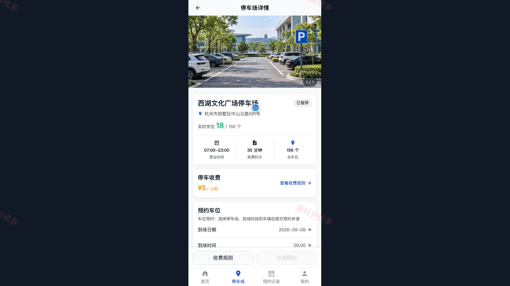
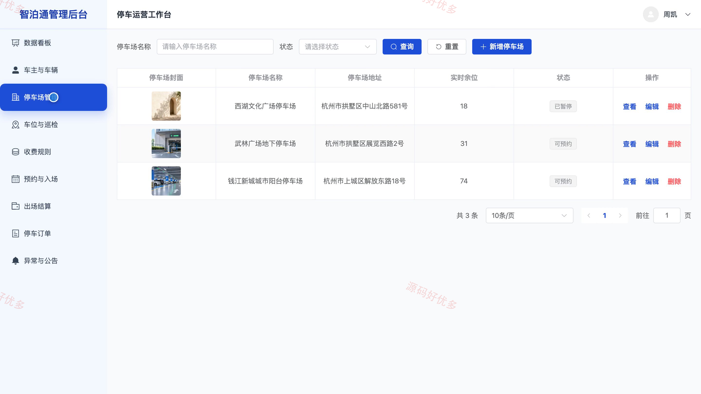

## 源码问题查看主页咨询

### 一、关键词
停车场管理、智慧停车、车位预约、停车缴费、停车服务

### 二、作品包含
源码+数据库+万字设计文档+PPT+全套环境和工具资源+本地部署教程

### 三、项目技术
前端技术： Html、Css、Js、Vue3.4、Element-Plus、uniapp
后端技术：Java、SpringBoot3.2.0、MyBatis-Plus

### 四、运行环境要求
开发工具：IDEA/eclipse + VSCODE + HBuilder X + 微信开发者工具

数据库：MySQL5.7+（共15张表）

数据库管理工具：Navicat10以上版本

环境配置软件： JDK17 + Maven3.6

前端Nodejs：16+

浏览器：谷歌浏览器

### 五、项目介绍
项目编号：bs013B

本系统围绕停车场车位查询、预约入场、停车计费与出场结算构建微信小程序和管理后台。车主可维护车辆资料、查询停车场余位与收费规则、预约车位并出示核验码，完成停车记录查询、模拟缴费和服务反馈；管理员可维护停车场、车位与收费规则，核验预约入场、办理出场结算，并通过数据看板掌握预约、订单和收入情况。系统通过预约核验码及车位状态联动减少重复占用，形成从预约到离场的完整停车服务流程。

角色：车主、管理员

车主功能：用户注册与登录、车辆信息维护、停车场余位与收费查询、车位预约与取消、预约记录与入场凭证、停车记录与费用明细、模拟缴费与结果查询、停车提醒与服务反馈。

管理员功能：后台登录与数据看板、车主账号与车辆管理、停车场信息管理、车位状态与巡检管理、收费规则管理、预约审核与入场核验、出场结算与停车订单管理、异常处理与公告反馈管理。

### 六、运行截图

